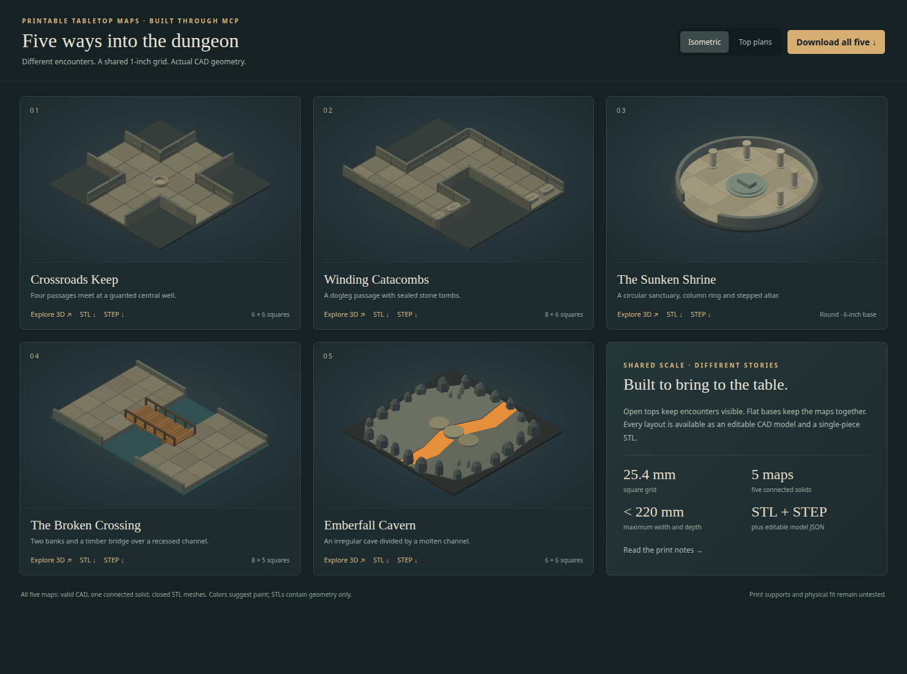

# Five printable dungeon maps through MCP

These five examples use the existing geometry engine through the local MCP
server to build tabletop maps, verify their geometry, and export STL and STEP.
The construction plans live in the calling script; no new engine operation,
model format, or map-specific agent harness is required.



| Map | Footprint, mm | Construction and encounter | Complete MCP request |
| --- | --- | --- | --- |
| Crossroads Keep | 158.0 × 158.0 | Four passages meeting at a central well | [map-crossroads](../tools/model/map-crossroads.request.json) |
| Winding Catacombs | 208.8 × 158.0 | Dogleg passage with four raised tombs | [map-catacombs](../tools/model/map-catacombs.request.json) |
| The Sunken Shrine | 152.4 × 152.4 | Circular sanctuary, five columns and stepped altar | [map-shrine](../tools/model/map-shrine.request.json) |
| The Broken Crossing | 208.8 × 132.6 | Two banks, timber bridge, handrails and support piers | [map-bridge](../tools/model/map-bridge.request.json) |
| Emberfall Cavern | 158.0 × 158.0 | Faceted cave perimeter, recessed lava channel and stepping stones | [map-cavern](../tools/model/map-cavern.request.json) |

The maps share a 25.4 mm (one-inch) grid. Open tops and low walls keep encounters
visible. Each map is a fixed, single-piece solid with its bottom at Z=0;
these examples have no locking tile connectors or moving mechanisms. Furniture
and terrain occupy some grid space, so the shared grid does not establish
miniature clearance. Gallery colors suggest paint; STL files contain geometry
only.

## Reproduce the five maps

From the repository root, first build the native bridge using
[Build and test](../README.md#build-and-test). Use the matching bridge when
building the Rust commands. The following assumes the native library is in
`build` and Cargo uses its default target directory:

```sh
OCCT_BRIDGE_LIB_DIR="$PWD/build" LD_LIBRARY_PATH="$PWD/build" \
  cargo build --manifest-path rust/occt-parametric/Cargo.toml --bins
python3 tools/model/maps/generate.py --check
LD_LIBRARY_PATH="$PWD/build" python3 tools/model/maps/build.py \
  --binary "$PWD/rust/occt-parametric/target/debug/occt-model" \
  --output /tmp/printable-dungeon-maps
python3 -m http.server 37431 --bind 127.0.0.1 \
  --directory /tmp/printable-dungeon-maps
```

Choose a new output directory: the replay script refuses to overwrite existing
builds. Open `http://127.0.0.1:37431` for the gallery, or open its self-contained
`index.html` locally. Drag to orbit, scroll to zoom, switch between isometric
and top views, and select **Explore 3D** for a larger map. The gallery embeds
native tessellated geometry and needs no external service.

[generate.py](../tools/model/maps/generate.py) contains the five explicit
construction recipes and writes the self-contained requests. Its `--check`
option detects drift. After deliberately changing a recipe or updating the
model schema, run it without `--check` to regenerate the examples at the
current schema version. The normal MCP example tests also validate every
request against the current engine schema.

## The MCP sequence

[build.py](../tools/model/maps/build.py) is a small stdio MCP client, so this
replay exercises the same interface available to an AI caller:

1. Initialize the server as described in [Launch and connect](../tools/model/MCP.md#launch-and-connect).
   Read `occt://catalog` and use `occt_get_schema` for the advertised request
   schema when authoring a new design.
2. Call `occt_get_example` with `{"name":"map-crossroads"}` (or one of the
   other four names). Pass the complete returned request to `occt_build`.
   Each request selects the final `map` feature and enables `stl`, `step`, and
   native `renders` with `views: ["iso", "top"]`.
3. Check the returned report, including every required verification result.
   Read the model, STEP, STL and image URIs in the returned `resources` map
   with MCP `resources/read`. Keep the accepted model for later edits.
4. Call `occt_visualize_model` on the same model with its named display parts
   as outputs. Read the resulting `view.json` resource to obtain native meshes
   for the colored comparison gallery. The final fused solid remains the
   export target.

Repeat with `map-catacombs`, `map-shrine`, `map-bridge`, and `map-cavern`.
The replay script fetches each example through MCP and checks that it matches
its authored recipe before building. Earlier accepted build directories remain
unchanged. Changes can follow the existing
[guarded model edit workflow](../tools/model/MCP.md#guarded-edits-and-revision-history).

## Artifacts and checks

Every map folder contains `map.stl`, `map.step`, editable `model.json`,
`request.json`, native `iso.png` and `top.png`, `report.json`, and
`mesh-checks.json`. The root includes the gallery, print notes, and
`printable-dungeon-maps.zip` containing all five map folders and the gallery.
Import the STL in millimeters at 100% scale.

All five builds passed native shape validity and required connectivity checks
for exactly one solid with no sealed voids. Their flat bottoms and footprints
below 220 × 220 mm were also checked. The delivered STL copies remove repeated
pole-vertex triangles where necessary and require exactly two incident triangles
per mesh edge, with vertices matched to five decimal places in millimeters.
The original accepted MCP exports remain unchanged. A regression test builds
all five examples through MCP and checks their exported meshes.

These checks establish the stated geometric properties; physical printing,
strength, supports, miniature clearance and fit remain untested. Review each
map in your slicer against your printer's actual usable bed area, especially
the bridge deck and rails. The footprint limit alone does not establish
support-free printing.

This is another example of [using the engine from an external AI design
system](AI_DESIGN_SYSTEMS.md): the caller supplies layout and domain detail,
and the engine supplies geometry, verification, editable state and exports.
